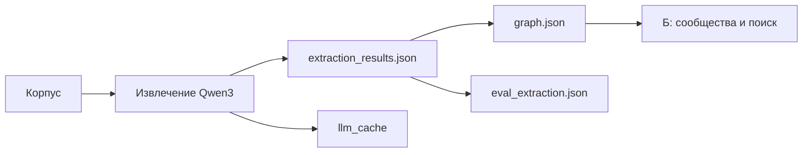

# Артефакты блока А

В этом каталоге передаётся граф документов для разработки блока Б. Полный общий индекс
с сообществами, поиском и агентом команда создаёт после интеграции остальных блоков.



Команды запуска и загрузки графа: [build_graph_index.md](../src/assistant/graphrag/build_graph_index.md).
Ход работ и решения: [WORK_LOG.md](../src/assistant/graphrag/WORK_LOG.md).
Материал для защиты: [DEFENSE.md](../src/assistant/graphrag/DEFENSE.md).

## Форматы и воспроизводимость

- graph.json содержит graph, nodes и edges в существующем формате инфраструктуры.
  Источники — chunk_id, вес ребра — число разных чанков.
- extraction_results.json содержит проверенный и нормализованный результат извлечения
  и diagnostics по каждому чанку; сырые ответы модели находятся в кеше.
- graph_stats.json описывает только блок А, содержит паспорт, хеши данных/кода и графа,
  отдельные числа удалённых сущностей и связей, вызовы и токены за текущий прогон.
- eval_extraction.json создаётся тем же оценщиком, что штатный eval-extraction.
- llm_cache содержит ответы существующего LLMClient. Точный запрос включает модель,
  инструкцию, текст чанка, JSON schema, seed, температуру и max_tokens.

Кеш содержит также ответы пробных инструкций; они не используются для нового запроса.
Для просмотра экспериментов оставлены smoke_v1–v4 и prompt_comparison в experiments/.
Кеш не является эталоном: при новом промпте ключ меняется, результат нужно оценивать снова.

Версия Ollama и digest модели записываются в graph_stats, если сервер предоставляет метаданные.
Один тег может со временем
указывать на другой digest; воспроизведение с переданным кешем не проверяет качество новой
сборки модели. Отдельное извлечение из кеша не требует эмбеддингов и ERP.

## Ограничения оценки

Precision/Recall здесь измеряют извлечение сущностей и связей по 16 gold-документам.
Это не точность ответов ассистента и не метрики четырёх режимов. Успешный полный прогон
должен охватить все 80 документов и 92 чанка; маленькие smoke-эксперименты его не заменяют.
## Результат полного прогона

| Проверка | Результат |
| --- | --- |
| Полный корпус | 80 документов, 92 чанка |
| Граф | 122 узла, 279 рёбер, 0 встречных конфликтов |
| Эталон | Все 16 документов |
| Связи: Precision / Recall | 1.000 / 1.000 |
| Сущности: Precision / Recall | 0.994 / 1.000 |
| Отклонено по всему корпусу | 1 сущность и 30 связей |
| Вызовы / входные / выходные токены | 92 / 127610 / 41661 |
| Повторная сборка | 92 из 92 ответов из кеша, граф и метрики идентичны |

На эталоне найдены 161 обязательная связь и 1 допустимая необязательная. Дополнительная
сущность, не разрешённая эталоном: Procedure:SP-115 в плановой чистке. Метрики остальных
64 документов без эталона этим прогоном не измеряются. Нулевое число встречных конфликтов
не доказывает отсутствие одиночных ошибок направления.

Счётчики стоимости логические: LLMClient считает кешированный вызов и его токены как обычный.
Первый полный прогон использовал 5 ответов из финального smoke-кеша, остальные 87 получил
от модели; его статистика сохранена в experiments/full_run_initial_stats.json.
После исправления enum-валидации весь прогон повторён из кеша, штатная команда
`python -m assistant eval-extraction` подтвердила те же метрики. Сводка проверок находится
в block_a_validation.json. Модель: Qwen3 4B, Ollama 0.40.15; точный digest — в graph_stats.json.

Независимый ревьюер восстановил все источники и веса по результатам чанков, пересчитал метрики
и повторил все 92 извлечения с транспортом, запрещающим любой сетевой вызов: кеш покрывает
весь прогон, результаты и диагностика совпали.

## Быстрая проверка переданной версии

Запускать из корня репозитория после синхронизации окружения:

```bash
uv run python - <<'PY'
import hashlib
import json
from pathlib import Path
from assistant.graphrag.build_graph_index import load_graph
from assistant.infra.schemas import RELATION_SIGNATURES

root = Path("artifacts")
graph = load_graph(root / "graph.json")
stats = json.loads((root / "graph_stats.json").read_text())
rows = json.loads((root / "extraction_results.json").read_text())
assert stats["documents"] == 80 and stats["chunks"] == len(rows) == 92
assert len({row["result"]["chunk_id"] for row in rows}) == 92
assert all(row["diagnostics"]["status"] == "ok" for row in rows)
assert hashlib.sha256((root / "graph.json").read_bytes()).hexdigest() == stats["graph_sha256"]
for source, target, edge in graph.edges(data=True):
    assert RELATION_SIGNATURES[edge["type"]] == (graph.nodes[source]["type"], graph.nodes[target]["type"])
    assert edge["weight"] == len(set(edge["sources"]))
for source, target in [
    ("Model:AR-210", "Part:P-1042"),
    ("ErrorCode:E-17", "Component:пусковое реле"),
    ("Part:P-1042", "Component:пусковое реле"),
    ("Part:P-1042", "Part:P-1042B"),
    ("Part:P-2054", "Part:P-2054B"),
    ("Part:P-2054B", "Part:P-2054C"),
]:
    assert graph.has_edge(source, target), (source, target)
print("Полнота, схема, веса и ключевые цепочки проверены")
PY
```
