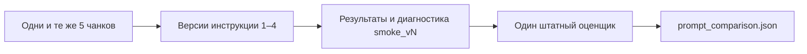

# Сравнение инструкций извлечения

9 ноября 2026. Модель: qwen3:4b-instruct-2507-q4_K_M, локальная Ollama.
Одинаковая выборка: manual_AR-210 (2 чанка), bulletin_SB-2025-03, procedure_SP-115,
report_R-2025-003. Это 5 чанков, 4 документа и 39 обязательных связей по gold.

| Версия | Изменение | Precision связей | Recall связей |
| --- | --- | --- | --- |
| 1 | Схема, словарь и пример замены | 1.000 | 0.795 |
| 2 | Ещё пример состава и усиленные инструкции | 1.000 | 0.769 |
| 3 | Кандидаты по типам и глобальное требование HAS_PART | 0.955 | 0.513 |
| 4 | Алфавитный порядок полей примеров и тематические подсказки | 1.000 | 1.000 |

smoke_vN содержит проверенный результат и диагностику того этапа, а не сырой текст ответа.
Версия 3 зафиксирована до добавления проверки самозамены: её ложная связь не скрыта.
Сырые ответы сохранены штатным кешем в ../llm_cache; точные запросы восстанавливаются
из соответствующей версии кода и исходных документов. Первый запрос соответствует ca75138,
финальный — af70f71; промежуточные инструкции описаны в журнале, но не имеют отдельных
коммитов. Поэтому для промежуточных версий сохранён результат, а не обещание повторного
получения точно такого же ответа новой моделью.

Нельзя приписывать рост качества одному фактору: порядок полей, язык инструкции и набор
подсказок изменялись совместно. Выборка использовалась для подбора запроса, поэтому её
идеальный Recall не является независимой оценкой. Основные метрики проекта считаются на
всех 16 gold-документах, включая эти четыре; отдельного скрытого теста у нас нет.

Остаточная ошибка версии 4: лишняя сущность Procedure у плановой чистки. Направление
INDICATES в отчёте иногда неверно — такая связь отклонена, обязательный FAILED сохранён.
Разбор решений находится в ../../src/assistant/graphrag/WORK_LOG.md.
