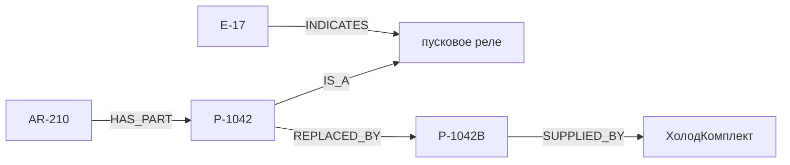

# Как объяснить блок А на защите

## Задача своими словами

Диспетчер знает модель холодильного оборудования и код ошибки. Ему нужна актуальная деталь.
Руководство связывает ошибку с узлом, а модель — с исходной деталью. Сервисный бюллетень
отдельно сообщает замену снятой детали. Похожесть текста на вопрос не гарантирует нахождение
всех звеньев. Мы извлекаем связи заранее, чтобы блок Б мог пройти нужную цепочку.

Это иллюстрация задачи из корпуса. Реальное наличие этих рёбер в переданном графе проверяется
отдельно. Цена, остатки и создание заказа относятся к ERP и агенту, а не к извлечению.

## Что делает модель, что делает код

| Модель | Код |
| --- | --- |
| Определяет смысл отношения между упомянутыми сущностями | Находит кандидаты кодов и словарных названий |
| Возвращает JSON с сущностями и связями | Проверяет структуру и нормализует имена |
| Может пропустить или перепутать факт | Удаляет неподтверждённые концы, неправильные типы и самозамену |
| Не определяет вес связи | Считает разные чанки-источники и разбирает встречные замены |

Числа и типы проверяются кодом, но смысловая истинность каждой связи полностью им не доказана.
Если оба кода есть в тексте, ошибочная связь между ними может пройти. Поэтому нужны метрики
и разбор конкретных ошибок, а не только зелёные тесты.

## Пять решений, которые нужно уметь объяснить

1. **Строгий разбор отдельно от фильтрации фактов.** Плохая структура требует нового ответа,
   а один плохой факт не должен уничтожать остальные правильные факты ответа.
2. **Диагностика отдельно от общей схемы.** Коллеги получают прежний ExtractionResult,
   а отчёт — отдельные причины удаления сущностей и связей, попытки и статус чанка.
3. **Вес через множество chunk_id.** Повтор одной строки или повторная доставка того же
   чанка не создают нового свидетельства. Разные чанки одного документа считаются разными.
4. **Конфликты после накопления всего корпуса.** Раннее удаление обратного ребра зависело бы
   от порядка документов. Сейчас сравниваются итоговые веса; равенство означает удаление обоих.
5. **Независимая сборка для команды.** Б получает настоящий граф раньше сообществ.
   Новый граф не смешивается со старыми сводками. Общая инфраструктура остаётся исходной.

## Как считать качество

Для каждого документа E — множество извлечённых связей, G — обязательные эталонные,
O — допустимые необязательные. Precision = |E ∩ (G ∪ O)| / |E|.
Recall = |E ∩ G| / |G|. В оценке присутствуют все 16 документов, включая корректные пустые.
Потерянное ребро может оборвать путь поиска, даже если остальные рёбра правильные.

Precision/Recall извлечения не равны точности ответов ассистента. Таблица четырёх режимов
и доля выдуманных фактов в ответах появляются только после интеграции блоков Б и В.
Наш dropped — это сущности плюс связи; для отчёта отдельное dropped_relations находится
в graph_stats.json. Число отклонённых фактов не равно числу всех ошибок модели:
пропущенные факты увеличивают потери Recall, а не dropped.

## Что показал TDD и что показала реальная модель

Unit-тесты с FakeLLM проверяют поведение кода на заданных ответах. Они не доказывают,
что настоящая Qwen3 найдёт все связи. В первых реальных опытах она пропустила HAS_PART,
перепутала тип модели и направление INDICATES. Усиление подсказок ухудшило часть ответов.
Сравнение четырёх версий инструкции и сырые результаты лежат в artifacts/experiments.

После изменения примеров и тематических подсказок на пробной выборке получены
Precision/Recall связей 1.000/1.000. Это четыре документа, не доказательство такого же
качества всего корпуса. Лишний регламент плановой чистки сохранён как остаточная ошибка.
Полный прогон: 80 документов / 92 чанка, 122 узла / 279 рёбер. На всех 16 gold-документах
Precision/Recall связей = 1.000/1.000, сущностей = 0.994/1.000. Метрики совпали при повторе
из кеша. Эталон остальных 64 документов отсутствует; скрытые вопросы здесь не оценивались.

## Связь с лекциями курса

Материал «Неделя 7: RAG и Tool Use.pdf» предоставлен отдельно в папке ai:

- страницы 3–4: передача контекста и ограничение ответа сведениями из него;
- страницы 24–25: метаданные чанков, источники и воспроизводимость экспериментов;
- страницы 34–35: оценка retrieval/генерации и GraphRAG с извлечением сущностей и связей;
- страница 40: цикл ReAct — объясняет, как наш граф далее использует агент.

Номера указаны по страницам PDF. RAGAS из лекции здесь не подключается: проект использует
готовый строковый оценщик. Векторный граф HNSW из курса и наш граф предметных фактов —
разные структуры с разным назначением.

## Где искать доказательства

Команды передачи и формат данных — build_graph_index.md. Направления и проверки —
extraction.md. Веса и конфликты — graph_builder.md. Ход тестов, неудачные эксперименты
и использование ИИ — WORK_LOG.md. Итоговые числа берутся из JSON, а не из ожидаемых значений.

Для целей команды 10+ нужны остальные блоки, чистый общий запуск, таблица четырёх режимов,
не меньше трёх ошибок с этапами возникновения и общий REPORT.pdf. Наш блок сам по себе
закрывает строку FR-1/FR-2 на 2 балла, когда выполнены тесты и построен полный граф.
