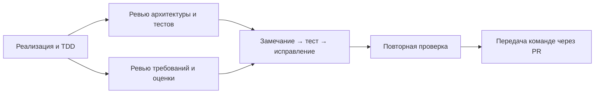

# Независимое ревью блока А

Ревью выполняют два субагента в режиме чтения. Основной поток отвечает за изменения,
тесты и публикацию. Это исключает конкурирующие правки общих файлов и сохраняет единый
контекст архитектурных решений. Ревью не заменяет тестирование на настоящей модели.

## Ревью архитектуры

На первом этапе независимо проверены 12 graph-тестов, включая обратное направление
замены с большим весом: существенных замечаний нет. На втором этапе проверены извлечение,
изменение кеш-ключа повторной попытки, строгий разбор и восстановление концов.
Рекомендация отдельно проверять diagnostics принята и покрыта сценариями восстановления
и двух неудач.

Во время экспериментов ревью сырых ответов помогло выявить фактический порядок полей JSON.
Гипотеза об обрезании ответа не подтвердилась на просмотренных чанках: контекст достаточен,
finish_reason=stop. Изменение порядка примеров и тематических подсказок проверено на одной
и той же пробной выборке; это не изолированный эксперимент над одним фактором.

## Ревью требований и передачи

| Замечание | Проверяемое исправление |
| --- | --- |
| Кешированный глобальный словарь мог отличаться от Settings.data_dir | Runner явно передаёт свой словарь; тест с отличающимися словарями |
| Новый graph.json мог остаться рядом со старыми сообществами | Отказ до обращения к модели при наличии communities/index_stats; два теста |
| Статистика повторного клиента включала прошлый прогон | Разность счётчиков; повторный запуск показывает 2 вызова вместо накопленных 4 |
| Оценщик может не учесть пропущенный gold-документ | Проверка полноты до и после извлечения, включая пустые результаты |
| Для отчёта нужен отдельный счётчик удалённых связей | dropped_entities/dropped_relations плюс причины в diagnostics |

Повторное ревью подтвердило исправления; все 10 тестов standalone runner прошли независимо.
Пофайловая атомарность публикации и её ограничение задокументированы.

## Состояние перед полным прогоном

Код: коммит af70f71. Оба ревьюера не обнаружили блокирующих замечаний.
Архитектурный ревьюер независимо запустил 136 проверок блока А, платформы и ERP.
Общий запуск тестов показывает 136 проходящих и 37 падающих тестов чужих заготовок Б/В.
Эти тесты не отключались; общая зелёная сборка требует интеграции остальных блоков.

Полнота реального графа, метрики и воспроизведение проверяются после завершения модельного
прогона и фиксируются в WORK_LOG.md и документации артефактов.

## Заключительное ревью

Дополнительная сверка с JSON schema нашла дефект: неизвестные enum-значения должны
вызывать повтор, а не отдельную фильтрацию. Четыре теста воспроизвели проблему; после
исправления 4018100 ревьюер подтвердил валидаторы всех четырёх полей и отсутствие регрессий.
Итог: 140 проходящих тестов блока А/платформы/ERP, 37 ожидаемых падений Б/В.

Ревью артефактов независимо подтвердило 80 документов, 92 чанка, 122 узла, 279 рёбер,
все веса и источники, SHA256 и отпечатки входных данных. Пересчитанные метрики совпали:
связи 1.000/1.000, сущности 0.994/1.000. Остаточная лишняя сущность — SP-115.
Все 92 извлечения повторены с транспортом, запрещающим сеть: результаты и диагностика
совпали. Блокирующих замечаний к коду и передаваемым артефактам нет.
