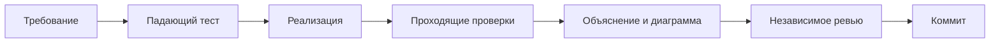

# Ход работы над блоком А

Автор: Yuliya Fayzieva. Дата начала: 9 ноября 2026 (Москва).

## Цель и договорённости

Передать двум участникам код FR-1/FR-2 и граф всего корпуса через PR в main.
Общие схемы, инфраструктуру, исходные контрактные тесты и чужие модули сохраняем.
Архитектурные решения принимаем по требованиям и проверкам, а не по числу строк.

## Исходная точка

- Прочитаны README и все семь документов docs, план команды из PDF.
- 13 контрактных тестов блока А падают на NotImplementedError.
- 92 теста платформы и ERP проходят; ruff проходит.
- Теория курса: «Неделя 7: RAG и Tool Use», внешняя папка ai.
- Для воспроизводимых проверок используем uv 0.10.8 и существующий uv.lock.

## Ревью плана

Два независимых субагента проверили архитектуру/TDD и требования/оценивание.
Приняты рекомендации: явный бюджет ответа модели; ошибки сервера не превращать в пустые
успешные результаты; восстановление концов связей; проверка полноты 16 gold-документов;
отдельные счётчики отброшенных сущностей и связей; паспорт прогона.
graph.json передаётся блоку Б напрямую: готовый load_kb требует ещё communities.json.
Фиктивные сообщества и частичный index_stats.json не создаём.

## Этап 1: граф (RED)

Добавлены проверки пустого графа, повторной доставки чанка, концов связи без отдельного
списка сущностей, изолированных сущностей, порядка источников и подсчёта конфликтов.
RED: выбранные 9 проверок упали на исходном NotImplementedError.
GREEN: все 6 дополнительных и 6 исходных graph-тестов прошли, ruff проходит.
Субагент архитектуры независимо проверил код и обратную замену с большим весом:
существенных замечаний нет. Решения и ограничения описаны в graph_builder.md.

## Этап 2: извлечение

RED: 11 дополнительных extraction-сценариев упали на NotImplementedError.
GREEN: 30 проверок (13 исходных + 17 дополнительных) проходят, ruff проходит.
Архитектура: строгая проверка структуры Pydantic отдельно от проверки фактов по тексту;
отдельная диагностика без изменения ExtractionResult; транспортные ошибки распространяются.
Подробности, альтернативы и диаграмма — extraction.md.
Субагент независимо подтвердил корректность извлечения; по его рекомендации добавлены
прямые проверки diagnostics для «ошибка → успех» и «две ошибки», а также лимита ответа.

## Этап 3: самостоятельная сборка

RED: тесты новой сборки не смогли импортировать ещё не существующий модуль.
GREEN: 6 сценариев новой сборки прошли после реализации; ruff проходит.
Общий индексатор не меняем. Отдельная сборка проверяет покрытие gold и неизменность входа,
сохраняет диагностику, подготавливает комплект JSON, затем публикует graph.json последним.
Подробности и инструкция передачи коллегам — build_graph_index.md.

## Эксперимент 1: реальная модель, исходная инструкция

Qwen3 точного тега из setup, 5 чанков 4 документов: руководство AR-210, бюллетень замены,
плановая чистка SP-115 и отчёт о выезде. Все ответы — корректный JSON, 5 вызовов,
5644 входных и 2070 выходных токенов. Бюллетень: 3 связи; руководство: 17 + 10;
плановая чистка: ожидаемо пусто; отчёт: 1 связь.

Найдены три конкретные ошибки модели:
1. В составе руководства пропущены все 8 HAS_PART: это обрывает путь от модели к детали.
2. AR-210 ошибочно назван ErrorCode: сущность отброшена проверкой типа кода.
3. В отчёте INDICATES направлена от Component к ErrorCode: связь отброшена проверкой схемы.

Следующий проверяемый шаг: добавить общий пример строки состава с тремя отношениями
HAS_PART/IS_A/SUPPLIED_BY и явно напомнить направление INDICATES и тип кода модели.
Исправления относятся к инструкции для всего корпуса; факты кодом не достраиваются.

## Ревью и исправления самостоятельной сборки

Ревью требований обнаружило, что переданный Settings мог расходиться с глобальным кешем
словаря. Словарь теперь явно передаётся в helper извлечения; отдельный тест использует
другой словарь и проверяет реальный узел. Публичный интерфейс extract_chunk сохранён.

Для предотвращения смешивания нового графа со старыми сообществами добавлен запрет запуска
в каталоге готового общего индекса. RED: обе проверки дошли до вызова FakeLLM и упали.
GREEN: отказ происходит до модели. Счётчики LLM теперь измеряются разностью начала/конца:
RED: повторный запуск показывал 4 вызова вместо 2; GREEN: каждый показывает 2.

## Эксперименты 2–4: изменение запроса

Сравнение выполнялось на тех же пяти чанках, без правки извлечённых фактов вручную.

| Версия | Изменение | Precision связей | Recall связей |
| --- | --- | --- | --- |
| 1 | Исходная инструкция | 1.000 | 0.795 |
| 2 | Дополнительный пример состава и усиление подсказок | 1.000 | 0.769 |
| 3 | Кандидаты по типам, глобальная подсказка HAS_PART | 0.955 | 0.513 |
| 4 | Примеры в порядке полей реального JSON, тематические подсказки | 1.000 | 1.000 |

Версия 2 ухудшила отчёт: номер отчёта принят за модель. Версия 3 загрязнила чанк ошибок
отношениями Model→Component HAS_PART и дала самозамену детали. Усиление инструкции
само по себе не улучшает результат. Субагент по сырым ответам заметил, что Ollama выводит
поля в алфавитном порядке: объект раньше отношения и субъекта. Примеры приведены к тому
же порядку; инструкция сокращена, подсказки включаются только при наличии нужных типов.
Контекст не был переполнен: сервер сообщает 32768 токенов, ответы завершены stop.
Это гипотеза по совокупному эксперименту: вклад каждого изменения отдельно не измерен.

Версия 4 нашла все 39 обязательных связей четырёх документов, без ложных принятых связей.
Остаётся лишняя изолированная Procedure в плановой чистке, Precision сущностей 0.976.
Это честно сохранённая ошибка, а не повод подставлять эталон в извлечение.
Наблюдаемая самозамена получила отдельную проверку: RED — принималась, GREEN —
отбрасывается как self_replacement. Ошибочные направления автоматически не переворачиваются.

Перед полным прогоном: 136 проверок блока А/платформы/ERP проходят, ruff проходит.

## Уточнение FR-1 во время полного прогона (RED)

Дополнительное буквальное ревью JSON schema показало: неизвестный enum — нарушение
схемы, а не просто неподтверждённый факт. Изначально проверялись строки и обязательные
поля, а неизвестные типы отбрасывались отдельно. Четыре новых теста воспроизвели дефект:
тип сущности, тип начала, тип конца и тип отношения вызывали один запрос вместо двух.
Исправление откладывается до завершения текущего прогона, чтобы не менять source hash
во время извлечения. Запрос валидного первого ответа меняться не должен; кеш пригоден
для последующей повторной сборки с более строгим валидатором.

GREEN: добавлены проверки всех enum по существующим реестрам схемы; четыре теста теперь
проходят. Подсказка повторной попытки напоминает о допустимых перечислениях.
Схема, реестр и запрос первой попытки остались прежними. Тесты блока А/платформы/ERP:
140 проходят; линтер проходит. Следующая сборка проверяет тот же кеш новым валидатором.

## Полный корпус и повтор из кеша

Реальный прогон завершён: 80 документов / 92 чанка, 122 узла / 279 рёбер, conflicts=0.
На 16 gold-документах Precision/Recall связей = 1.000/1.000, сущностей = 0.994/1.000.
Найдены все 161 обязательная и 1 допустимая связь. Лишняя сущность: Procedure:SP-115.
По всему корпусу отфильтрованы 1 сущность и 30 связей, все ответы разобраны с первой попытки.
Расход: 92 логических вызова, 127610 входных и 41661 выходной токен; изначально 5 cache hits.

После строгой enum-валидации повтор завершён за доли секунды с 92 cache hits из 92.
Байты graph.json и метрики совпали с первым прогоном. Штатный eval-extraction дал те же числа.
Проверены схема, источники, веса и обе ключевые цепочки замен; block_a_validation.json
содержит результат и SHA256 графа. Начальная статистика сохранена отдельно в experiments.

Независимый ревьюер восстановил граф из результатов чанков и подтвердил метрики/хеши.
Дополнительно он воспроизвёл все извлечения с MockTransport, запрещающим сеть: 92 cache hits,
результаты и diagnostics совпали. Факты вне 16 gold-документов ещё не проверены эталоном.

## Использование ИИ

Codex помогает исследовать репозиторий, составлять тесты и код, описывать решения.
Субагенты выполняют независимое ревью. Фактические результаты получаем командами,
а качество извлечения измеряем на настоящей Qwen3; FakeLLM используется только в тестах.
