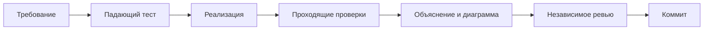

# Ход работы над блоком А

Автор: Yuliya Fayzieva. Дата начала: 9 ноября 2026 (Москва).

## Цель и договорённости

Передать двум участникам код FR-1/FR-2 и граф всего корпуса через PR в main.
Общие схемы, инфраструктуру, исходные контрактные тесты и чужие модули сохраняем.
Архитектурные решения принимаем по требованиям и проверкам, а не по числу строк.

## Исходная точка

- Прочитаны README и все семь документов docs, план команды из PDF.
- 13 контрактных тестов блока А падают на NotImplementedError.
- 92 теста платформы и ERP проходят; ruff проходит.
- Теория курса: «Неделя 7: RAG и Tool Use», внешняя папка ai.
- Для воспроизводимых проверок используем uv 0.10.8 и существующий uv.lock.

## Ревью плана

Два независимых субагента проверили архитектуру/TDD и требования/оценивание.
Приняты рекомендации: явный бюджет ответа модели; ошибки сервера не превращать в пустые
успешные результаты; восстановление концов связей; проверка полноты 16 gold-документов;
отдельные счётчики отброшенных сущностей и связей; паспорт прогона.
graph.json передаётся блоку Б напрямую: готовый load_kb требует ещё communities.json.
Фиктивные сообщества и частичный index_stats.json не создаём.

## Этап 1: граф (RED)

Добавлены проверки пустого графа, повторной доставки чанка, концов связи без отдельного
списка сущностей, изолированных сущностей, порядка источников и подсчёта конфликтов.
RED: выбранные 9 проверок упали на исходном NotImplementedError.
GREEN: все 6 дополнительных и 6 исходных graph-тестов прошли, ruff проходит.
Субагент архитектуры независимо проверил код и обратную замену с большим весом:
существенных замечаний нет. Решения и ограничения описаны в graph_builder.md.

## Этап 2: извлечение

RED: 11 дополнительных extraction-сценариев упали на NotImplementedError.
GREEN: 30 проверок (13 исходных + 17 дополнительных) проходят, ruff проходит.
Архитектура: строгая проверка структуры Pydantic отдельно от проверки фактов по тексту;
отдельная диагностика без изменения ExtractionResult; транспортные ошибки распространяются.
Подробности, альтернативы и диаграмма — extraction.md.

## Использование ИИ

Codex помогает исследовать репозиторий, составлять тесты и код, описывать решения.
Субагенты выполняют независимое ревью. Фактические результаты получаем командами,
а качество извлечения измеряем на настоящей Qwen3; FakeLLM используется только в тестах.
