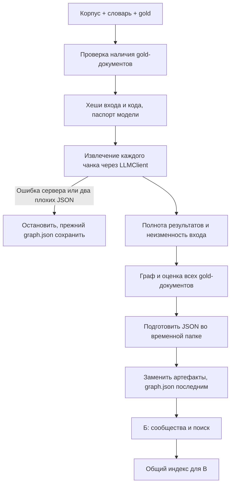

# Передача блока А: самостоятельная сборка графа

## Зачем отдельный запуск

Штатный make index после извлечения вызывает detect_communities и summarize_community
из блока Б. Пока они не написаны, это блокирует передачу настоящего графа.
Новый модуль вызывает те же extract_with_diagnostics/build_graph, но не вызывает Б или В.
Публичные интерфейсы платформы и формат graph.json остаются прежними.



## Запуск с корня репозитория

```bash
uv sync --frozen
ollama pull qwen3:4b-instruct-2507-q4_K_M
uv run python -m assistant.graphrag.build_graph_index
uv run python -m assistant eval-extraction
```

Без установленного глобально uv можно использовать `.venv/bin/uv`.
Если в artifacts уже лежит общий индекс с communities.json или index_stats.json,
сборка останавливается до обращения к модели. Для эксперимента задайте другой каталог:
`ARTIFACTS_DIR=artifacts/block_a_experiment uv run python -m assistant.graphrag.build_graph_index`.
Это исключает смешивание нового графа со старыми сообществами.
Settings читает переменные окружения; самостоятельный Python автоматически не загружает .env.
Локальный адрес по умолчанию — http://localhost:11434/v1. Эмбеддинги и ERP блоку А не нужны.
В Docker запуск: `docker compose run --rm app python -m assistant.graphrag.build_graph_index`.

## Что получает команда

| Артефакт | Назначение |
| --- | --- |
| artifacts/graph.json | Граф полного корпуса в штатном формате |
| artifacts/extraction_results.json | Результат и отдельная диагностика каждого чанка |
| artifacts/graph_stats.json | Размер, полнота, отброшенные факты, модель, хеши, вызовы и токены |
| artifacts/eval_extraction.json | Штатные Precision/Recall сущностей и связей |
| artifacts/llm_cache/ | Кеш LLMClient для воспроизведения извлечения |

graph_stats содержит отдельные dropped_entities и dropped_relations, поскольку для отчёта
нужно число отброшенных связей, а общий dropped объединяет оба типа.
При испорченном ответе extraction_failures.json сохраняет уже пройденные чанки и причину.
При транспортном сбое выводится текущий chunk_id; успешные ответы уже находятся в кеше.
После исправления повторный запуск продолжает работу за счёт кеша, а не ручных правок графа.

## Как блоку Б загрузить граф

```python
from pathlib import Path
from assistant.graphrag.build_graph_index import load_graph

graph = load_graph(Path("artifacts/graph.json"))
print(graph.nodes["Part:P-1042"])
print(graph.edges["Part:P-1042", "Part:P-1042B"])
```

Для локальных экспериментов KnowledgeBase можно собрать программно с реальным графом и
собственными сообществами. Штатный load_kb требует communities.json: его создаёт блок Б.
До этого В использует исходные fixtures. Пустой communities.json не подставляется.
После интеграции команда выполняет обычный make index: он строит полный index_stats.json,
сообщества и сводки. graph_stats.json не выдаётся за статистику полного индекса.

## Архитектурные решения и ограничения

- Общий конвейер не меняем: это сохраняет совместимость и не затрагивает работу коллег.
- gold читается только для оценки и проверки покрытия, в извлечение не передаётся.
- Словарь читается из переданного Settings.data_dir и явно передаётся извлечению.
  Публичный extract_chunk сохраняет прежнюю сигнатуру и штатную загрузку словаря.
- Публикация начинается после успешного извлечения всех чанков и проверки неизменности входа.
  Каждый файл заменяется атомарно, graph.json последним. Это не транзакция всего каталога:
  при аварии между заменами следует повторить запуск и сверить graph_sha256 в stats.
- metadata содержит коммит, признак незакоммиченных файлов, digest модели и версию Ollama,
  если сервер предоставляет эти API. Секреты и полный набор переменных окружения не сохраняются.
- Реальный корпус ожидается из 80 документов и 92 чанков. Модуль также работает с небольшим
  корпусом для тестов; проверка конкретного полного прогона зафиксирована отдельно.

Тесты проверяют совместимую загрузку, полный gold включая пустые результаты, повторяемость,
отсутствие communities/index_stats, ошибки JSON и сервера, изменение данных во время прогона.
