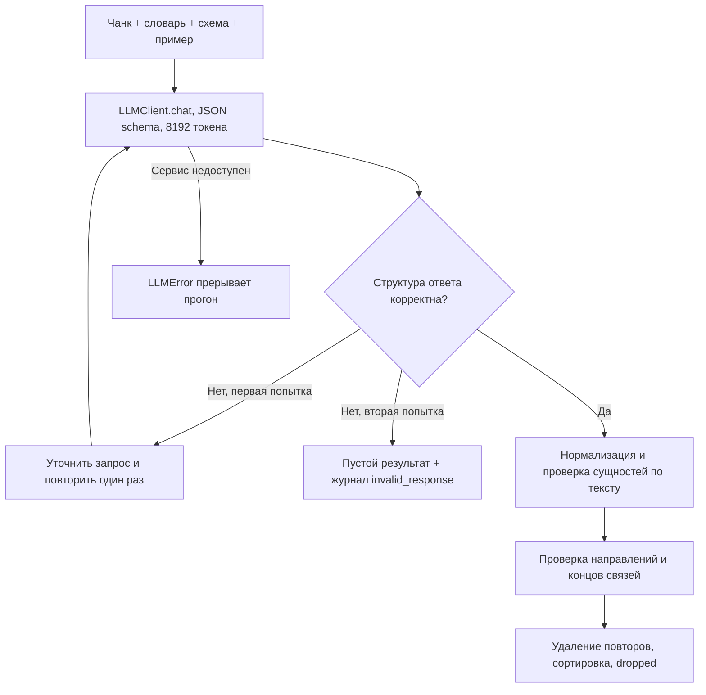

# Извлечение: FR-1

## Границы ответственности

Публичная функция extract_chunk возвращает существующий ExtractionResult. Внутренний
extract_with_diagnostics выполняет тот же алгоритм и дополнительно возвращает журнал.
Отдельный индексатор использует журнал для анализа ошибок, штатный — прежний интерфейс.
Глобальных изменяемых счётчиков нет: диагностика принадлежит одному чанку.

## Архитектурное решение: два уровня проверки

Pydantic проверяет структуру строго: массивы объектов, обязательные поля, строковые значения.
Числа и null не превращаются в названия. Некорректная структура вызывает повтор всего
извлечения. Правильно оформленный, но недопустимый факт удаляется отдельно; валидные факты
из такого ответа сохраняются. Неизвестные типы и отношения также отбрасываются как факты.

Готовые canonical_name, find_codes и find_names обеспечивают единые правила со всей
платформой. Подтверждённые концы связей добавляются в сущности, даже если модель забыла
указать их в entities. Неуспешная связь не добавляет новые изолированные концы.
Направление проверяется по RELATION_SIGNATURES, общий файл схем не изменяется.

Альтернатива — доверять только JSON schema сервера — не защищает от выдуманных кодов.
Альтернатива — принимать лишь связь между явно перечисленными entities — теряет правильные
факты и нарушает исходный контракт. Разделение структуры и фактов сохраняет пригодные данные.

## Повторы, кеш и диагностика

Лимит ответа 8192 вместо стандартных 1024: руководство содержит много связей, короткий
ответ обрезает JSON. Повтор содержит дополнительную инструкцию, поэтому получает отдельный
ключ штатного кеша. Низкая температура и seed задаются существующим LLMClient.
Пустой корректный JSON не повторяется. Ошибка сервера не маскируется под пустой документ.

В diagnostics записываются число попыток, ошибки разбора и каждый удалённый факт с причиной.
dropped = число удалённых явных сущностей + число удалённых связей. Плохой конец учитывается
как часть удалённой связи, дополнительно — только если был отдельным элементом entities.
Нормализованные дубликаты удаляются без увеличения dropped. Это позволяет отдельно показать
число удалённых связей в отчёте, не меняя общую схему.

## Ограничения и связь с теорией

Названия ищутся существующей функцией find_names в словарной форме. Падежная форма без
словарной формы в тексте может быть потеряна. Наличие концов не доказывает истинность связи:
модель может ошибиться между двумя реально упомянутыми деталями. Это измеряется Precision,
а потери фактов — Recall. Веса и встречные замены проверяются следующим этапом.

Теория: курс, «Неделя 7: RAG и Tool Use», ограничения параметрических знаний, передача
контекста, проверка найденных данных; docs/theory.md — извлечение графа и направления.
Текст чанка помечен как данные, а источники остаются в chunk_id/doc_id.

## Проверки

Исходные 7 extraction-тестов и 11 дополнительных сценариев проходят. Они проверяют
нормализацию, выдумки, отсутствие названий в тексте, концы только в relations, повторы,
строгие типы, изменённый запрос повторной попытки, пустой JSON, недоступность сервера и журнал.
Реальные эксперименты и последующие изменения записываются в [WORK_LOG.md](WORK_LOG.md).
