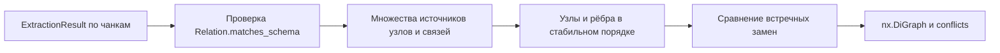
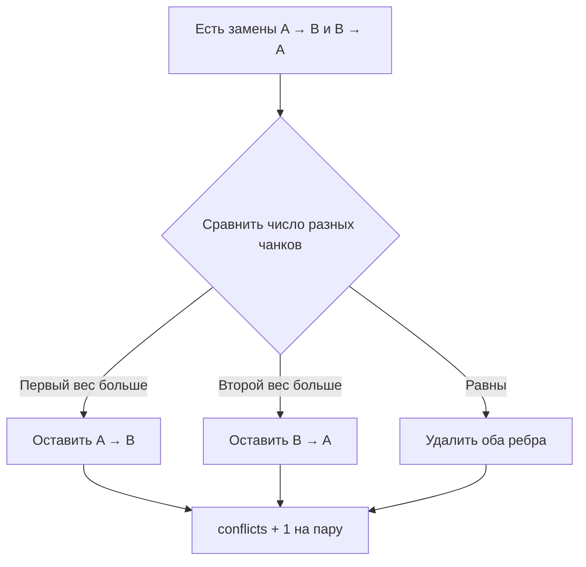

# Сборка графа: FR-2

## Решение

Вход — результаты извлечения по чанкам. Выход — nx.DiGraph с неизменным контрактом.
Сначала накапливаем множества источников, затем создаём граф, затем разрешаем конфликты.
Это отделяет сбор доказательств от принятия решения о направлении замены.

## Почему так

Счётчик на каждое появление связи завысил бы вес при повторе в одном ответе или повторной
доставке чанка. Множество chunk_id обеспечивает идемпотентность: вес равен числу разных
чанков, а не числу строк или документов. Поэтому один документ с двумя чанками может дать вес 2.
Источники узлов включают и явно перечисленные сущности, и концы принятых связей.
Изолированные сущности сохраняются. Некорректная связь не добавляет собственных концов.

MultiDiGraph не нужен: текущая схема допускает только один тип отношения для каждой
конкретной пары типов узлов. При расширении схемы это предположение нужно пересмотреть.
Узлы, рёбра и источники сортируются для воспроизводимого JSON и удобного сравнения.

## Конфликты

Каждая пара рассматривается один раз по порядку node_id. Удаление ребра не удаляет узлы
и их источники: факт упоминания сущности остаётся верным. Вес — число свидетельств,
а не вероятность истинности. Ошибку направления без встречного ребра этот алгоритм не обнаруживает.

## Проверки

Исходные контрактные тесты проверяют объединение, вес, схему и оба исхода конфликта.
Дополнительные тесты проверяют пустой вход, повторы чанка, изолированные сущности,
восстановление концов, независимость от порядка входа и два отдельных конфликта.
Хронология фактических RED/GREEN — в [WORK_LOG.md](WORK_LOG.md).
