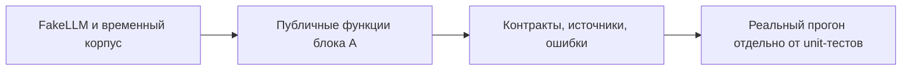

# Проверки блока А

Исходные контрактные тесты остаются в tests/contract/test_extraction_and_graph.py.
Здесь дополнительные проверки отказов, воспроизводимости и отдельной сборки графа.
Объяснения реализации и результаты RED/GREEN находятся рядом с кодом в
src/assistant/graphrag/WORK_LOG.md и документации соответствующих модулей.

Запуск: `uv run pytest -q tests/block_a tests/contract/test_extraction_and_graph.py`.
